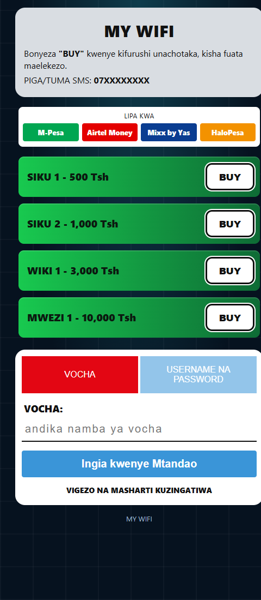
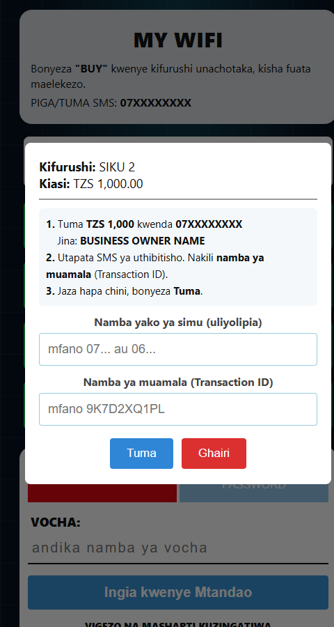
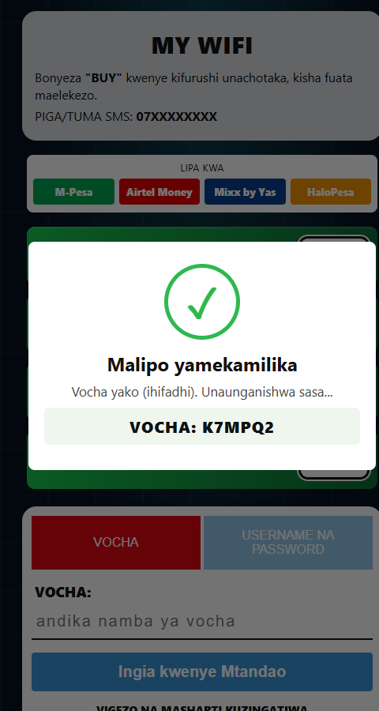

# WiFi Hotspot Portal

Mobile-first **captive portal (login page) for MikroTik hotspots**: customers pick a package, pay by mobile money
(M-Pesa, Airtel Money, Mixx by Yas, HaloPesa) and are logged in automatically once the payment is confirmed. They
can also log in with a printed voucher or a username/password.

Backend: **[wifi-hotspot-admin](https://github.com/massawes/wifi-hotspot-admin)**.

| Packages | Payment steps | Paid → auto login |
|---|---|---|
|  |  |  |

## Features

* One self-contained `login.html` (no external CSS/JS/fonts: nothing loads before the customer is online).
* Packages, business name and payment number come from the server (`api/info.php`), with a built-in fallback.
* Payment flow: instructions → phone + transaction ID → waits for approval (manual or SMS auto-match) →
  shows the voucher and logs in with **HTTP-CHAP** (MD5 implemented inline).
* Survives the customer closing the page: a pending order is remembered and resumed.
* Voucher tab (code = username = password) and username/password tab.
* Works with RouterOS 6 and 7 template variables (`$(link-login-only)`, `$(chap-id)`, `$(mac)`, `$(error)` …)
  and still renders when opened as a plain file for preview.

## Install on the router

1. Edit the top of the `<script>`: `API = 'https://YOUR-SERVER/wifi-hotspot-admin/api/'` and the fallback `INFO`.
2. Copy the router's default hotspot folder (e.g. `flash/hotspot`) to a new folder, replace `login.html` with this file.
3. `/ip hotspot profile set [find name=YOUR-PROFILE] html-directory=flash/YOUR-FOLDER`
4. Walled garden so the page can reach the server before login:
   `/ip hotspot walled-garden add dst-host=YOUR-SERVER action=allow`

The customer interface is in Kiswahili (Tanzania).

## Author

Vincent Massawe – [github.com/massawes](https://github.com/massawes)
